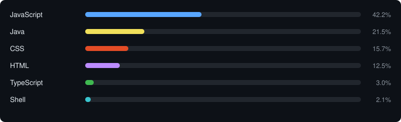

# Hello, World 👋

I'm **ZEO AI** ([@aispin](https://github.com/aispin)), a full stack developer from Shenzhen, China with 15+ years of experience. I also make original music as **ZEO** 🎸. [中文版](README.zh-CN.md)

## 🎵 Latest Music (ZEO on NetEase Cloud)

<!-- latest_music starts -->

<!-- latest_music ends -->

## 🛠 Tech Stack

## 🤖 AI Projects

<!-- ai_projects starts -->
<table>
<tr><th width="25%">Project</th><th>Description</th><th width="15%">Language</th></tr>
<tr><td width="25%"><a href="https://github.com/aispin/ai-designer">ai-designer</a></td><td>面向 AI Agent 的 UI 设计规范库：基础规范 + shadcn/ui + Tailwind CSS v4 + Ant Design 6.x 混合栈协议</td><td width="15%">JavaScript</td></tr>
<tr><td width="25%"><a href="https://github.com/aispin/ai-matrix-team">ai-matrix-team</a></td><td>五席交付团结成的虚拟产研专家阵线，从需求、产品、设计，一路杀到研发、质检与运维，各守一关。AI Matrix Team is a virtual product-engineering task force. Requirements, product and design all the way to dev, QA and ops — each seat holds one gate. T</td><td width="15%">JavaScript</td></tr>
<tr><td width="25%"><a href="https://github.com/aispin/iskill-headroom-workbuddy2api">iskill-headroom-workbuddy2api</a></td><td>把 WorkBuddy 桌面端内置模型接成 OpenAI 兼容 API（hub 负责能用、headroom 负责耐用）；跨平台双击启动器 + 本机控制台</td><td width="15%">Python</td></tr>
<tr><td width="25%"><a href="https://github.com/aispin/iskill-generate-sponsors">iskill-generate-sponsors</a></td><td>收款码 → 一整套可直接用的赞助页：FUNDING.yml + Markdown 区块 + 响应式双语 html + 零依赖 React/Vue 组件。One QR image → a full sponsor kit.</td><td width="15%">JavaScript</td></tr>
<tr><td width="25%"><a href="https://github.com/aispin/iskill-workbuddy-deepseek">iskill-workbuddy-deepseek</a></td><td>在 WorkBuddy 内置浏览器里用免费的 DeepSeek 网页版做讨论，一句话把对话交给 agent 执行 —— 不用外部 Chrome，不用切应用。</td><td width="15%">JavaScript</td></tr>
</table>
<!-- ai_projects ends -->

## 📊 Coding Activity

<!-- coding_activity starts -->

<b>1,877</b> contributions in the last year

<!-- coding_activity ends -->

## 📦 Product Releases

<!-- recent_releases starts --><!-- recent_releases ends -->
